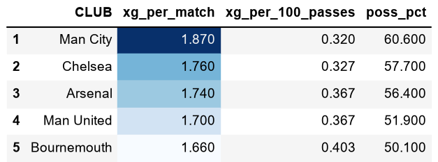
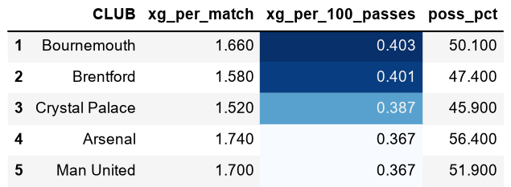
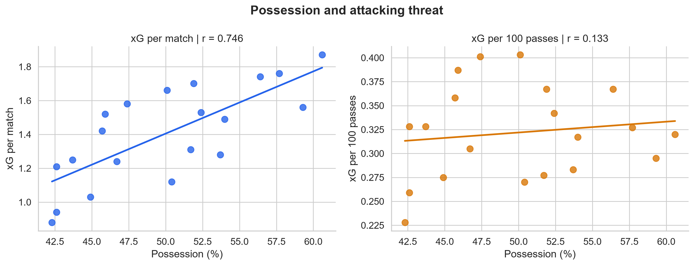

# Football xG & Possession Analysis

**Premier League 2025/26 · SQL & Python**

## 1. Η ιδέα και το ερώτημα

Θέλαμε να συγκρίνουμε την απειλή ομάδων που παίζουν διαφορετικά: άλλες κρατούν πολύ την μπάλα και άλλες επιτίθενται πιο άμεσα. Η σκέψη είναι ότι μια ομάδα μπορεί να συγκεντρώνει περισσότερο xG επειδή έχει περισσότερη μπάλα και περισσότερες επιθέσεις.

Γι’ αυτό δοκιμάσαμε το **xG ανά 100 προσπάθειες πάσας**. Αντί να κοιτάμε μόνο πόσο xG δημιούργησε μια ομάδα, κοιτάμε πόσο δημιούργησε **σε σχέση με τις πάσες που έκανε**. Έτσι μπορεί να αναδειχθεί και μια ομάδα που δημιουργεί απειλή χωρίς πολλή κυκλοφορία και με πιο άμεσο ποδόσφαιρο.

Όμως έπρεπε να εξετάσουμε αν ο υπολογισμός ανά 100 πάσες πετυχαίνει αυτό που θέλαμε: να συνδέεται λιγότερο με την κατοχή.

Γι’ αυτό κοιτάξαμε τις ίδιες 20 ομάδες με δύο τρόπους. Αρχικά εξετάσαμε αν οι ομάδες με περισσότερη κατοχή είχαν συνήθως περισσότερο xG ανά αγώνα. Έπειτα εξετάσαμε αν οι ομάδες με περισσότερη κατοχή είχαν συνήθως περισσότερο xG ανά 100 πάσες. Αν η δεύτερη σχέση ήταν ασθενέστερη, θα είχαμε ένδειξη ότι το νέο μετρικό λειτουργεί προς την κατεύθυνση που θέλαμε.

**Το βασικό ερώτημα:** συνδέεται το xG ανά 100 πάσες λιγότερο με την κατοχή από το xG ανά αγώνα;

## 2. Δεδομένα

Πηγή: [StatMuse — Premier League 2025/26](https://www.statmuse.com/fc/ask?q=premier+league+teams+amount+of+passes+2025-26).

Η ανάλυση περιλαμβάνει **20 ομάδες**, με συγκεντρωτικά στοιχεία σεζόν. Χρησιμοποιήθηκαν αγώνες, γκολ, xG, σουτ, προσπάθειες πάσας (`PASS-ATT`) και μέση κατοχή (`POSS%`).

Τα στοιχεία μεταφέρθηκαν σε Excel και αποθηκεύτηκαν ως CSV. Όλα προέρχονται από την ίδια πηγή.

## 3. Προετοιμασία και υπολογισμοί

### SQL — MySQL μέσω DBeaver

**Κώδικας:** [SQL scripts](sql/).

- Εισαγωγή του CSV και επιβεβαίωση 20 γραμμών και 20 διαφορετικών ομάδων.
- Διόρθωση της μορφής των τιμών στις δύο στήλες πάσας.
- Μετατροπή των στηλών που χρησιμοποιούνται σε κατάλληλους αριθμητικούς τύπους.
- Δημιουργία του view `football_metrics` και κατατάξεων με `RANK() OVER`.
- Εξαγωγή των μετρικών σε CSV για την Python.

| Μετρικό | Υπολογισμός | Τι δείχνει |
|---|---|---|
| Γκολ ανά αγώνα | Γκολ / αγώνες | Πόσα γκολ πετυχαίνει η ομάδα ανά αγώνα |
| xG ανά αγώνα | xG / αγώνες | Πόσο xG δημιουργεί ανά αγώνα |
| xG ανά σουτ | xG / σουτ | Τη μέση ποιότητα των σουτ |
| xG ανά 100 πάσες | xG / προσπάθειες πάσας × 100 | Πόσο xG δημιουργεί σε σχέση με τις πάσες της |

Οι 100 πάσες επιλέχθηκαν μόνο για ευκολότερη ανάγνωση.

### Python — Jupyter Notebook

**Κώδικας και αποτελέσματα:** [football_analysis.ipynb](football_analysis.ipynb).

Έλεγχος τύπων, ελλειπουσών τιμών και διπλών ομάδων με pandas. Δημιουργία Top 5, γραφημάτων με Matplotlib/Seaborn και στατιστικού ελέγχου με SciPy.

## 4. Σύγκριση ομάδων

Τα δύο Top 5 παρουσιάζουν τα δύο μετρικά και την κατοχή, ώστε η σύγκριση να είναι άμεση.

<table>
<tr>
<th>Top 5 — xG ανά αγώνα</th>
<th>Top 5 — xG ανά 100 πάσες</th>
</tr>
<tr>
<td width="50%"></td>
<td width="50%"></td>
</tr>
</table>

Η **Manchester City** έχει **1,87 xG ανά αγώνα**, έναντι **1,66** της Bournemouth. Αν όμως εξετάσουμε το xG ανά 100 πάσες, η **Bournemouth έχει 0,403**, έναντι **0,320** της City.

Η City δημιουργεί περισσότερο xG ανά αγώνα· η Bournemouth περισσότερο xG σε σχέση με τις πάσες της.

## 5. Σχέση με την κατοχή και στατιστικός έλεγχος

Όμως έπρεπε να εξετάσουμε **αν ο υπολογισμός ανά 100 πάσες συνδέεται πράγματι λιγότερο με την κατοχή**.

Κοιτάξαμε τις ίδιες ομάδες με δύο τρόπους:

- **r1:** οι ομάδες με περισσότερη κατοχή έχουν συνήθως περισσότερο xG ανά αγώνα;
- **r2:** οι ομάδες με περισσότερη κατοχή έχουν συνήθως περισσότερο xG ανά 100 πάσες;

Η συσχέτιση Pearson δείχνει πόσο έντονα μεταβάλλονται μαζί δύο μεγέθη. Θετική τιμή κοντά στο 1 δείχνει ισχυρή θετική γραμμική σχέση· κοντά στο 0, ασθενή.

### Υποθέσεις

- **Η₀:** με το νέο μετρικό, η σχέση με την κατοχή παραμένει εξίσου ισχυρή ή γίνεται ισχυρότερη.
- **Η₁:** με το νέο μετρικό, η σχέση με την κατοχή γίνεται ασθενέστερη.

Χρησιμοποιήθηκε ο **μονόπλευρος, προσεγγιστικός z-έλεγχος Pearson–Filon** για δύο συσχετίσεις από τις ίδιες ομάδες, με κοινή μεταβλητή την κατοχή. Ο υπολογισμός λαμβάνει υπόψη και τη συσχέτιση μεταξύ των δύο μετρικών xG.

Και τα δύο r είναι θετικά, οπότε εδώ `r1 − r2 = |r1| − |r2|`. Δεν χρησιμοποιήθηκε bootstrap.

### Αποτέλεσμα

| Μέγεθος | Τιμή |
|---|---:|
| r1 — Κατοχή και xG ανά αγώνα | 0,746 |
| r2 — Κατοχή και xG ανά 100 πάσες | 0,133 |
| Διαφορά r1 − r2 | 0,613 |
| z | 3,752 |
| Μονόπλευρο p-value | 0,00008783 |

Οι ομάδες με πολλή κατοχή είχαν συνήθως υψηλό xG ανά αγώνα, αλλά **δεν είχαν αντίστοιχα υψηλό xG ανά 100 πάσες**.

Με όριο σημαντικότητας 5%, απορρίπτεται η Η₀: η μείωση είναι στατιστικά σημαντική στον προσεγγιστικό έλεγχο, υπό τις παραδοχές του.

## 6. Συμπέρασμα και περιορισμοί

**Στη συγκεκριμένη σεζόν, το xG ανά 100 πάσες συνδέεται πολύ λιγότερο με την κατοχή από το xG ανά αγώνα.** Αυτό στηρίζει τη χρήση του ως συμπληρωματικού τρόπου σύγκρισης της απειλής ομάδων διαφορετικού στιλ.

Δεν αποτελεί συνολική κατάταξη επιθετικής δύναμης ούτε αποδεικνύει πλήρη αφαίρεση της επίδρασης της κατοχής.

Η στατιστική ένδειξη αντιμετωπίζεται ως **διερευνητική**:

- Υπάρχουν μόνο 20 παρατηρήσεις από μία σεζόν.
- Ο έλεγχος χρησιμοποιεί προσέγγιση μεγάλης δειγματοληψίας και προϋποθέσεις κατανομής.
- Αντιμετωπίζει τις ομάδες ως ανεξάρτητες, παρότι αγωνίζονται μεταξύ τους.
- Οι πάσες εκφράζουν και το στιλ παιχνιδιού· δεν είναι ταυτόσημες με την κατοχή.

## 7. Αρχεία και εκτέλεση

| Αρχείο / φάκελος | Περιεχόμενο |
|---|---|
| [sql/](sql/) | Δημιουργία βάσης και πίνακα, καθαρισμός και SQL ανάλυση |
| [data_raw/](data_raw/) | Αρχικό CSV |
| [data_clean/football_metrics.csv](data_clean/football_metrics.csv) | Μετρικά που εξήχθησαν από την SQL |
| [football_analysis.ipynb](football_analysis.ipynb) | Python ανάλυση και στατιστικός έλεγχος |
| [images/](images/) | Γραφήματα και πίνακες σε PNG |

Κρατήστε την ίδια δομή φακέλων και εκτελέστε τα κελιά του notebook με τη σειρά. Βιβλιοθήκες: pandas, NumPy, Matplotlib, Seaborn, SciPy και dataframe_image για την εξαγωγή πινάκων.

Για εκτέλεση της SQL, ξεκινήστε από καθαρή βάση και εισαγωγή του αρχικού CSV. Το UPDATE διόρθωσης των πασών εκτελείται **μία φορά**, πριν από τις μετατροπές τύπων.

**Αναφορά μεθόδου:** [cocor — Pearson and Filon's z για εξαρτημένες συσχετίσεις](https://search.r-project.org/CRAN/refmans/cocor/html/cocor.dep.groups.overlap.html).
